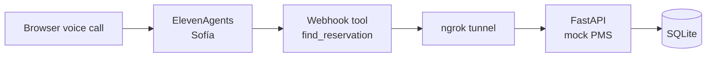
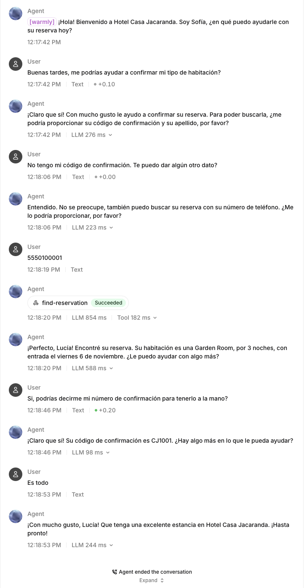
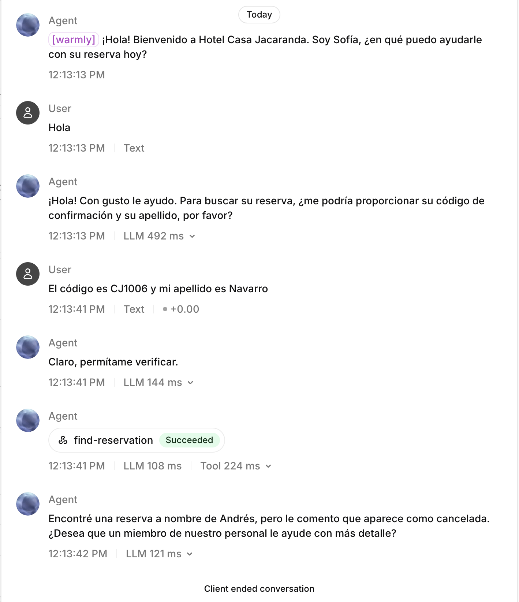

# Hotel Casa Jacaranda: ElevenLabs voice agent demo

This is a personal project to learn the ElevenLabs platform. It has three parts:

1. A small Text to Speech test. A Python script turns text into speech and saves an MP3.
2. A mock PMS (property management system) for a hotel, built with FastAPI and SQLite.
3. A voice agent called Sofía, built with ElevenAgents. Sofía speaks Mexican Spanish. During a call, she can look up a reservation in the mock PMS.

> **Note:** Hotel Casa Jacaranda is not a real hotel. All guests, phone numbers and reservations are invented.
> This is a personal project. It is not affiliated with or endorsed by ElevenLabs.

## Architecture



The guest talks to Sofía in the browser. When Sofía needs reservation data, she calls the `find_reservation` webhook tool. The tool sends a POST request through an ngrok tunnel to the FastAPI app on my laptop. The app reads the reservation from SQLite and returns JSON. Sofía uses that JSON to answer the guest.

## Status

What works today:

- The Text to Speech script creates an MP3 from a short text.
- The mock PMS has four tool endpoints. All of them have tests.
- Sofía is configured in the ElevenLabs dashboard, not in code. The system prompt and tool settings are in [docs/agent-setup.md](docs/agent-setup.md).
- `find_reservation` is connected to Sofía. I tested it with a live call in the browser, and it returned the correct reservation.

What comes next:

- Only `find_reservation` is connected to the agent. The other endpoints (`check-availability`, `request-late-checkout`, `create-ticket`) exist and are tested, but Sofía does not use them yet.
- There is no post-call webhook yet.
- There is no phone channel yet. Calls only work in the browser.
- There is no demo video yet.

## Repo structure

```
.
├── README.md
├── docs/
│   ├── agent-setup.md    Sofía's system prompt and tool configuration
│   └── images/           screenshots
├── tts/
│   ├── eleven_api.py     Text to Speech test
│   ├── requirements.txt
│   └── .env.example
└── pms/
    ├── README.md         more PMS details: demo data and curl examples
    ├── app/              FastAPI app
    ├── scripts/seed.py   demo data
    ├── tests/            pytest tests
    ├── requirements.txt
    └── .env.example
```

## Setup (macOS)

You need Python 3.9 or newer. One virtual environment at the repo root is used for both parts.

```bash
git clone https://github.com/eduardo-bravo-dl/elevenlabs-demo.git
cd elevenlabs-demo
python3 -m venv .venv
source .venv/bin/activate
pip install -r tts/requirements.txt -r pms/requirements.txt
```

Each part reads its own `.env.local` file. Create them from the examples:

```bash
cp tts/.env.example tts/.env.local
cp pms/.env.example pms/.env.local
```

Then edit both files:

- In `tts/.env.local`, set `ELEVENLABS_API_KEY` to your ElevenLabs API key.
- In `pms/.env.local`, set `TOOL_SECRET` to a long random string. The PMS does not start with the placeholder value. You can create a random string like this:

```bash
python3 -c "import secrets; print(secrets.token_urlsafe(32))"
```

The `.env.local` files are in `.gitignore`. Do not commit them.

## Text to Speech script

The script sends one English sentence to the ElevenLabs Text to Speech API. It uses the `eleven_v3` model and a fixed voice ID. It saves the audio as `output.mp3`.

```bash
cd tts
python eleven_api.py
```

Run it from the `tts/` folder, because it reads `.env.local` from the current folder. Each run uses ElevenLabs credits.

## Mock PMS

Run these commands from the repo root, with the virtual environment active.

Load the demo data. This deletes the old data and creates reservations with dates relative to today:

```bash
cd pms
python -m scripts.seed
```

Start the server:

```bash
uvicorn app.main:create_app --factory --reload
```

The API is now at http://127.0.0.1:8000. The interactive docs are at http://127.0.0.1:8000/docs.

Run the tests. They use a temporary database, so the server does not need to run:

```bash
pytest -q
```

### Endpoints

| Method | Path | Auth | Purpose | Connected to Sofía |
| --- | --- | --- | --- | --- |
| GET | `/health` | none | Check that the server runs. Also shows the failure mode. | no |
| POST | `/tools/find-reservation` | `X-Tool-Secret` | Find a reservation by confirmation code and last name, or by phone | yes |
| POST | `/tools/check-availability` | `X-Tool-Secret` | Room types, price per night and total price in MXN | not yet |
| POST | `/tools/request-late-checkout` | `X-Tool-Secret` | Late checkout until 14:00, if the rules allow it | not yet |
| POST | `/tools/create-ticket` | `X-Tool-Secret` | Hand off a request to hotel staff | not yet |

### Example: find a reservation

In a second terminal, from the `pms/` folder:

```bash
export PMS=http://127.0.0.1:8000
export SECRET=$(grep '^TOOL_SECRET=' .env.local | cut -d= -f2-)

curl -s -X POST $PMS/tools/find-reservation \
  -H "X-Tool-Secret: $SECRET" -H "Content-Type: application/json" \
  -d '{"confirmation_code": "CJ1003", "last_name": "Castillo"}'
```

The response has `"found": true`, the reservation details, and a short `message`. The demo data and more curl examples are in [pms/README.md](pms/README.md).

## Connect the agent

Sofía runs in the ElevenLabs cloud, so she cannot reach `127.0.0.1`. I use ngrok to give the local server a public HTTPS URL.

1. Start the PMS server (see above).
2. Install ngrok and add your auth token:

   ```bash
   brew install ngrok
   ngrok config add-authtoken YOUR-NGROK-AUTHTOKEN
   ```

3. Open a tunnel to port 8000:

   ```bash
   ngrok http 8000
   ```

4. Copy the HTTPS forwarding URL, for example `https://YOUR-URL.ngrok-free.app`.
5. Check the tunnel:

   ```bash
   curl -s https://YOUR-URL.ngrok-free.app/health
   ```

6. In the ElevenLabs dashboard, set the `find_reservation` tool URL to `https://YOUR-URL.ngrok-free.app/tools/find-reservation`, and set the `X-Tool-Secret` header to your `TOOL_SECRET`.

The free ngrok plan gives you one dev domain, and it stays the same when you restart ngrok. If it ever changes, update the tool URL in the dashboard.

The full agent configuration is in [docs/agent-setup.md](docs/agent-setup.md).

## Design choices

- **Business results return HTTP 200.** "Reservation not found" or "room sold out" is a normal answer, not an error. The response has a status field (`found`, `available`, `approved` or `status`) and a short `message` that the agent can read aloud. Error codes are only for real problems: 401 for a missing or wrong secret, 422 for an invalid request, and 503 for a PMS outage.
- **Mexican phone numbers are normalized.** `55 5010 0001`, `+52 55 5010 0001` and the old mobile format `+521 55 5010 0001` all match the same guest.
- **Last names match without accents.** `Hernandez` matches `Hernández`.
- **Tool endpoints use a shared secret header.** Every `/tools/*` request needs `X-Tool-Secret`. The server compares it in constant time, and it refuses to start with the placeholder secret.
- **Failures can be simulated.** Set `PMS_FAILURE_MODE` to `timeout` or `error` in `pms/.env.local` to test how the agent handles a slow or broken PMS. Both return 503.
- **Demo dates stay fresh.** The seed script creates dates relative to today in the `America/Mexico_City` time zone.
- **Logs are safe to share.** Logs are JSON, phone numbers are masked to the last 4 digits, and the secret is never logged.
- **Messages are in English.** The PMS writes its `message` fields in English. Sofía uses this data but answers the guest in Spanish.

## Screenshots

These are test conversations in the ElevenLabs dashboard. The guest messages were typed, not spoken.

Lookup by phone. The guest has no confirmation code, so Sofía asks for a phone number. The tool finds Lucía's reservation (CJ1001).



Cancelled reservation. The tool finds CJ1006, and Sofía tells the guest that it was cancelled.


